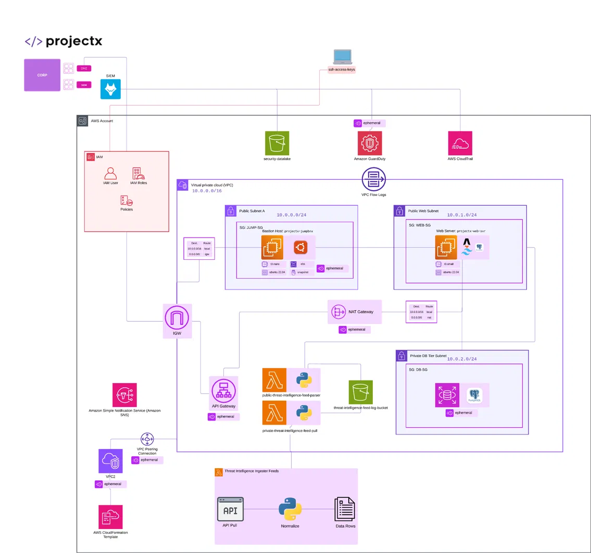

# AWS Cloud & Attacks 101: Secure Network Build

A hands-on AWS project building a segmented, monitored production-style network, then layering detection and threat intelligence on top. The initial builds are intentionally insecure, reflecting common mistakes made when provisioning cloud resources. These misconfigurations are then exploited to demonstrate their impact, and finally remediated to show how each flaw is fixed. 
Built following Grant Collins' *Cloud & Attacks 101* (projectsecurity). Where I deviated from or extended the course, it is called out in the docs.

**Status:** In progress (phases 1 to 5 of 9 complete)

## Architecture



**Traffic flow**

| Path | Allowed | Why |
|------|---------|-----|
| Internet → Web server | HTTP/HTTPS via IGW | Public-facing tier only |
| Admin → Jumpbox | SSH from my IP only | Single, hardened entry point |
| Jumpbox → Web server | SSH | No direct SSH from the internet to the web tier |
| Web server → DB | PostgreSQL port from WEB-SG only | DB lives in a private subnet, no route to the internet |
| Private resources → Internet | Outbound only via NAT Gateway | Updates and API pulls without inbound exposure |

## Components

| Layer     | Resource                                                                              | Purpose                                               |
| --------- | ------------------------------------------------------------------------------------- | ----------------------------------------------------- |
| Identity  | IAM admin user, roles, policies                                                       | Least privilege, no day-to-day root use               |
| Network   | VPC `10.0.0.0/16`, 3 subnets, IGW, NAT, route tables                                  | Segmentation by tier                                  |
| Compute   | `projectx-jumpbox` (t3.micro), `projectx-prod-websvr-public` (t3.small), Ubuntu 22.04 | Bastion and web tier                                  |
| Data      | PostgreSQL in private subnet                                                          | Isolated data tier                                    |
| Detection | CloudTrail, VPC Flow Logs, S3 security data lake                                      | Visibility and logging                                |
| Pipeline  | Lambda (Python) threat intel feeds, API Gateway, SNS                                  | Ingest and normalize threat data                      |
| SIEM      | Wazuh integration                                                                     | Centralized detection; runs on an Ubuntu EC2 instance |

## Progress

| #   | Phase                           | Status      | Doc                                                              |
| --- | ------------------------------- | ----------- | ---------------------------------------------------------------- |
| 1   | IAM setup                       | Done        | [docs/01-iam-setup.md](docs/01-iam-setup.md)                     |
| 2   | VPC networking                  | Done        | [docs/02-vpc-networking.md](docs/02-vpc-networking.md)           |
| 3   | Compute: jumpbox and web server | Done        | [docs/03-compute-jumpbox-web.md](docs/03-compute-jumpbox-web.md) |
| 4   | Database                        | Done        | [docs/04-database.md](docs/04-database.md)                       |
| 5   | Monitoring and logging          | Done        | [docs/05-monitoring-logging](docs/05-monitoring-logging.md)      |
| 6   | SIEM integration                | In progress |                                                                  |
| 7   | Threat intelligence pipeline    | Planned     |                                                                  |
| 8   | Attacks                         | Planned     |                                                                  |
| 9   | Remediations                    | Planned     |                                                                  |

## Key design decisions

| Decision                                                      | Reason                                                        | Tradeoff                                                    |
| ------------------------------------------------------------- | ------------------------------------------------------------- | ----------------------------------------------------------- |
| Bastion host for admin access                                 | One audited SSH entry point, smaller attack surface           | Single access point to maintain and secure                  |
| Database in a private subnet                                  | No internet path to the data tier                             | Reachable only via the web server or jumpbox                |
| IAM users instead of IAM Identity Center                      | Simpler for a single-account lab                              | Long-lived access keys, not suitable at scale               |
| Wazuh instead of GuardDuty                                    | Hands-on detection practice, lower cost                       | No managed threat intelligence                              |
| Wazuh installed manually on Ubuntu EC2, not the pre-built AMI | Practice with the full deployment and configuration           | Slower to set up                                            |
| Recursive logging disabled                                    | Prevents a feedback loop of log writes generating more logs   | No visibility into activity on the data lake bucket itself  |
| No CloudWatch Logs                                            | S3 as the single log destination, no duplicate ingestion cost | No real-time metric filters or alarms                       |
| 14-day log retention                                          | Controls storage cost within the credit budget                | Limited forensic history, no long-term compliance retention |
See [docs/05-monitoring-logging.md](docs/05-monitoring-logging.md) for detail on the logging decisions.
## Skills demonstrated

AWS IAM, VPC design, Security groups and route tables, EC2, Bastion architecture, Logging and detection (in progress), Documentation, S3, RDS, CloudTrail, VPC Flow Logs, Wazuh/SIEM, and log retention design.

## Lessons learned
- **RDS needs a DB subnet group across at least two AZs**, even for a single-AZ instance, so the network has to plan for a second private subnet up front.
- **Each logging service needs its own bucket policy statement** before it can write to S3, and missing ones fail silently with no logs arriving.
- **Installing Wazuh manually** taught me how its components fit together in a way the pre-built AMI would have hidden. 
 
<!-- Fill in as you go: 2 to 3 real problems you hit and how you fixed them -->

## Cost and cleanup

* **NAT Gateway and Elastic IPs** bill hourly, so both were deprovisioned after use. 
* **Log lifecycle rules** delete CloudTrail and VPC Flow Logs after 14 days.
* **Instances** (including the Wazuh server) are stopped when not in use.
* The account runs on the AWS paid plan, drawing on Free Tier credits.
* Monthly budget alert set at $20.00

## Repo structure

```
architecture/   topology diagram
docs/           step-by-step write-up per phase
infra/          IAM policy JSON, security group rules, CloudFormation
scripts/        Lambda and helper scripts
screenshots/    evidence per phase
project-log.md  dated build journal
```

> No credentials, keys or account IDs are committed. Identifiers in screenshots are redacted.
