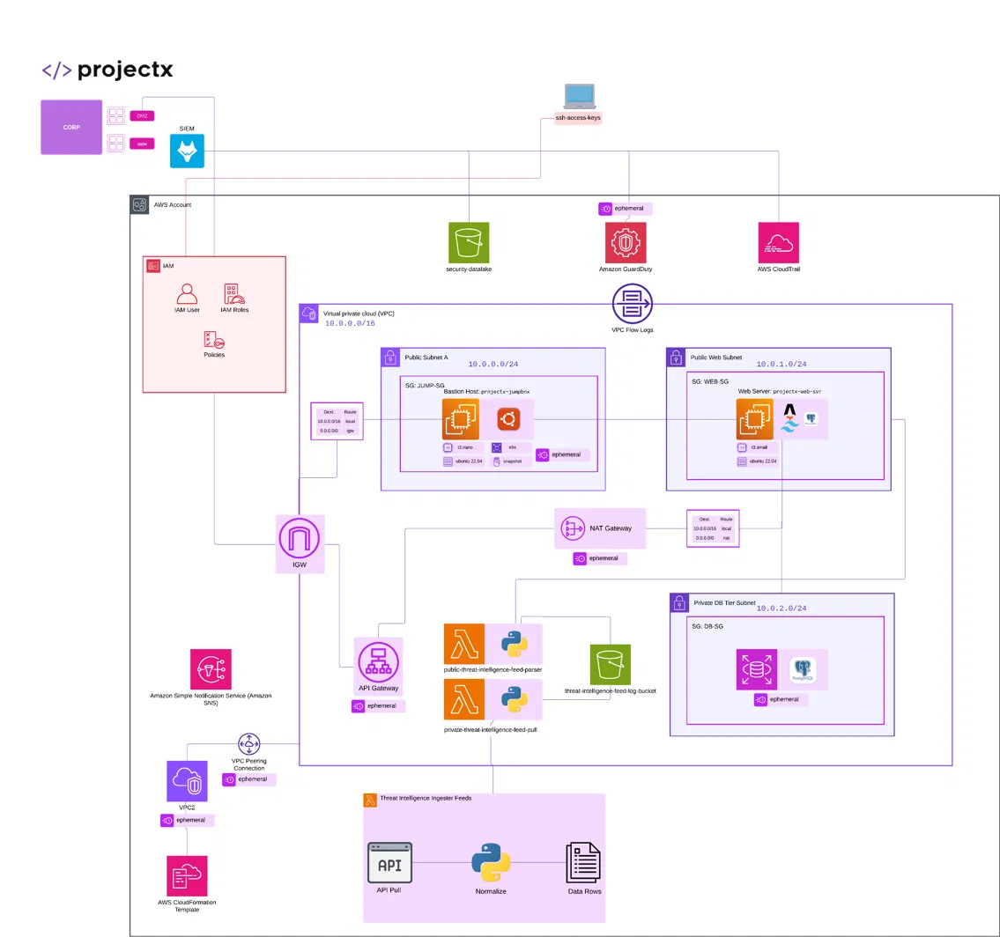

# AWS Cloud & Attacks 101: Secure Network Build

A hands-on AWS project building a segmented, monitored production-style network, then layering detection and threat intelligence on top. Built following Grant Collins' *Cloud & Attacks 101* (projectsecurity). Where I deviated from or extended the course, it is called out in the docs.

**Status:** In progress (phases 1 to 3 of 7 complete)

## Architecture



**Traffic flow**

| Path | Allowed | Why |
|------|---------|-----|
| Internet → Web server | HTTP/HTTPS via IGW | Public-facing tier only |
| Admin → Jumpbox | SSH from my IP only | Single, hardened entry point |
| Jumpbox → Web server | SSH | No direct SSH from the internet to the web tier |
| Web server → DB | PostgreSQL port from WEB-SG only | DB lives in a private subnet, no route to the internet |
| Private resources → Internet | Outbound only via NAT Gateway | Updates and API pulls without inbound exposure |

## Components

| Layer | Resource | Purpose |
|-------|----------|---------|
| Identity | IAM admin user, roles, policies | Least privilege, no day-to-day root use |
| Network | VPC `10.0.0.0/16`, 3 subnets, IGW, NAT, route tables | Segmentation by tier |
| Compute | `projectx-jumpbox` (t3.nano), `projectx-web-svr` (t3.small), Ubuntu 22.04 | Bastion and web tier |
| Data | PostgreSQL in private subnet | Isolated data tier |
| Detection | GuardDuty, CloudTrail, VPC Flow Logs, S3 security data lake | Visibility and logging |
| Pipeline | Lambda (Python) threat intel feeds, API Gateway, SNS | Ingest and normalize threat data |
| SIEM | Wazuh integration | Centralized detection |

## Progress

| # | Phase | Status | Doc |
|---|-------|--------|-----|
| 1 | IAM setup | Done | [docs/01-iam-setup.md](docs/01-iam-setup.md) |
| 2 | VPC networking | Done | [docs/02-vpc-networking.md](docs/02-vpc-networking.md) |
| 3 | Compute: jumpbox and web server | Done | [docs/03-compute-jumpbox-web.md](docs/03-compute-jumpbox-web.md) |
| 4 | Database | Planned | |
| 5 | Monitoring and logging | Planned | |
| 6 | Threat intelligence pipeline | Planned | |
| 7 | SIEM integration | Planned | |

## Key design decisions

- **Bastion host instead of public SSH on every server:** one audited entry point, smaller attack surface.
- **Private DB subnet:** the database has no route to the IGW, so it cannot be reached from the internet even if a security group is misconfigured.
- **NAT Gateway for outbound only:** private resources can pull updates without accepting inbound connections.
- **Security groups reference each other** (e.g. DB-SG allows WEB-SG) rather than IP ranges, so rules stay tight as instances change.
- **Least-privilege IAM:** <!-- add: what you did differently from root, and any policies you scoped -->

## Skills demonstrated

AWS IAM · VPC design · Security groups and route tables · EC2 · Bastion architecture · Logging and detection (in progress) · Documentation

## Lessons learned

<!-- Fill in as you go: 2 to 3 real problems you hit and how you fixed them -->

## Cost and cleanup

<!-- Note which resources you stop or tear down between sessions (NAT Gateway bills hourly) -->

## Repo structure

```
architecture/   topology diagram
docs/           step-by-step write-up per phase
infra/          IAM policy JSON, security group rules, CloudFormation
scripts/        Lambda and helper scripts
screenshots/    evidence per phase
project-log.md  dated build journal
```

> No credentials, keys or account IDs are committed. Identifiers in screenshots are redacted.
