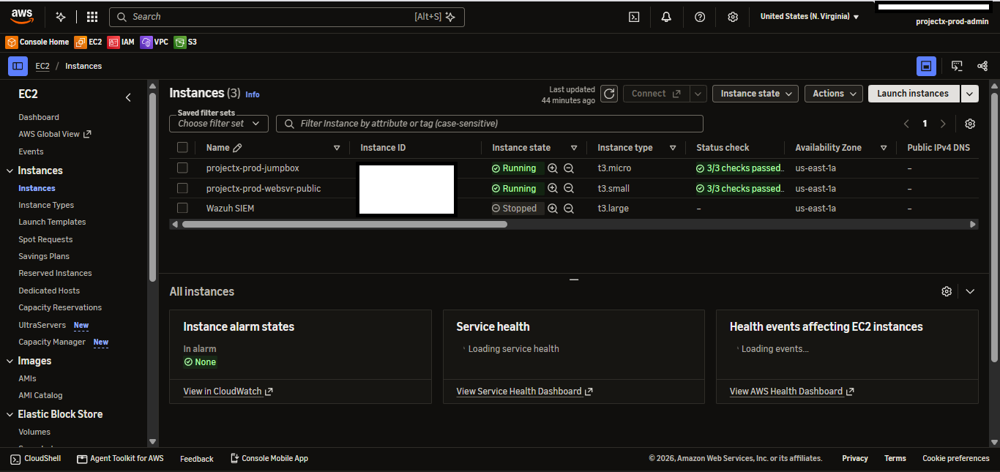

# 03: Compute (Jumpbox and Web Server)

## Goal

Deploy a bastion host and a web server, with security groups that make the jumpbox the only SSH entry point into the environment.

## Why

Exposing SSH on every server multiplies the attack surface and the logs to monitor. A single hardened jumpbox gives one place to control, restrict, and audit administrative access. The web server then accepts SSH only from the jumpbox, so it is never directly reachable for administration from the internet.

## Design

| Resource     | Name               | Type / OS              | Subnet                                            | Security group           |
| ------------ | ------------------ | ---------------------- | ------------------------------------------------- | ------------------------ |
| Bastion host | `projectx-jumpbox` | t3.micro, Ubuntu 22.04 | `projectx-prod-public-subnet` (`10.0.0.0/24`)     | projectx-prod-jumpbox-sg |
| Web server   | `projectx-web-svr` | t3.small, Ubuntu 22.04 | `projectx-prod-private-web-subnet`(`10.0.1.0/24`) | projectx-prod-websvr-sg  |
| SIEM         | Wazuh SIEM         | t3.large, Ubuntu 22.04 |                                                   | wazuh-siem-sg            |

## Security group rules

| SG                       | Direction | Port      | Source                      | Reason                       |
| ------------------------ | --------- | --------- | --------------------------- | ---------------------------- |
| projectx-prod-jumpbox-sg | Inbound   | 22        | My IP only                  | Only I can reach the bastion |
| projectx-prod-websvr-sg  | Inbound   | 80/443    | `0.0.0.0/0`                 | Public web traffic           |
| projectx-prod-websvr-sg  | Inbound   | 22        | projectx-prod-jumpbox-sg    | SSH only via the jumpbox     |
| wazuh-siem-sg            | Inbound   | 22/443    | My IP only                  |                              |
| wazuh-siem-sg            | Inbound   | 1514/1515 | projectx-prod-public-subnet |                              |

**Key decision:** 
1. `projectx-prod-websvr-sg` references `projectx-prod-jumpbox-sg` as the source instead of an IP range, so the rule follows the jumpbox even if its address changes, and nothing else can use it. 
2. Wazuh offers a pre-built AMI on the AWS Marketplace that provisions a working instance quickly. I chose to launch a standard Ubuntu EC2 instance and install Wazuh manually instead, mainly as practice with the deployment and configuration process..<!-- add anything you decided differently -->

## What I did

Launched both instances with key pair `desktop-key-pair-useast1`, attached the security groups above, and set up the web application on `projectx-web-svr` (<!-- stack, e.g. Astro frontend -->).

## Verification

```bash
EC2 Instances
```




## Production hardening

- Replace SSH keys with AWS Systems Manager Session Manager, removing the need for an open port 22 and a bastion
- Use IAM roles on instances instead of stored credentials
- Restrict the jumpbox further (MFA, session logging, patching schedule)
