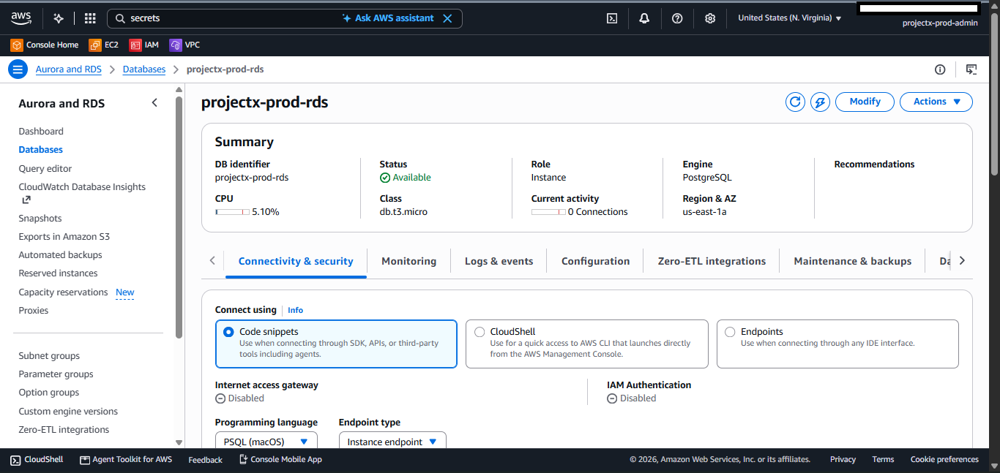
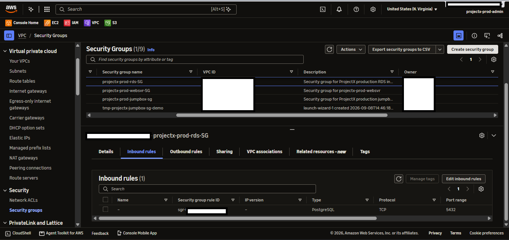

# 04: Database

## Goal

Deploy a PostgreSQL database in the private tier, reachable only from the web server.

## Why

The database holds the data worth protecting, so it gets the strictest placement: a private subnet with no route to the internet gateway, and a security group that trusts only the web tier. Even if the web server's rules were misconfigured or an attacker scanned the public address space, there is no path to the database from outside the VPC.

## Design

| Component      | Value                                                                 | Purpose                                                                                      |
| -------------- | --------------------------------------------------------------------- | -------------------------------------------------------------------------------------------- |
| Engine         | PostgreSQL on Amazon RDS <!-- confirm: RDS or self-managed on EC2 --> | Application data store                                                                       |
| Subnet         | Private DB subnet (`10.0.2.0/24`)                                     | No route to the IGW                                                                          |
| Subnet group   | `projectx-prod-private-db-subnet` and `projectx-private-db-sub2`      | Two private DB subnets across two AZs (us-east-1a, us-east-1b), grouped in a DB subnet group |
| Security group | `projectx-prod-rds-SG`                                                | Allows PostgreSQL from `projectx-prod-websvr-sg` only                                        |
| Public access  | Disabled                                                              | No public IP assigned                                                                        |

## Security group rules

| SG    | Direction | Port | Source                    | Reason                                   |
| ----- | --------- | ---- | ------------------------- | ---------------------------------------- |
| DB-SG | Inbound   | 5432 | `projectx-prod-websvr-sg` | Only the web tier can query the database |

**Key decision:** 
1. `projectx-prod-rds-SG` references `projectx-prod-websvr-sg` instead of the web subnet's CIDR, so access follows the web server itself and nothing else in the subnet can connect.
2. RDS requires a DB subnet group spanning at least two AZs. The instance runs Single-AZ to control cost, but the subnet group allows Multi-AZ later without redesigning the network

## Verification

```bash
# From the web server: connect to the database
psql -h <db-endpoint> -U <db-user> -d <db-name>
```

- Connection from the web server succeeds
- Connection from my laptop or the jumpbox times out (expected: no route or rule)




<!-- One screenshot: DB-SG rules, and the RDS config showing Public access = No. Redact endpoint and IDs. -->


## Production hardening

- Enable encryption at rest and require TLS for connections
- Store credentials in AWS Secrets Manager with rotation, not in app config
- Use IAM database authentication where the engine supports it
- Enable Multi-AZ, automated backups, and deletion protection
- Turn on database audit logging and send it to the SIEM
