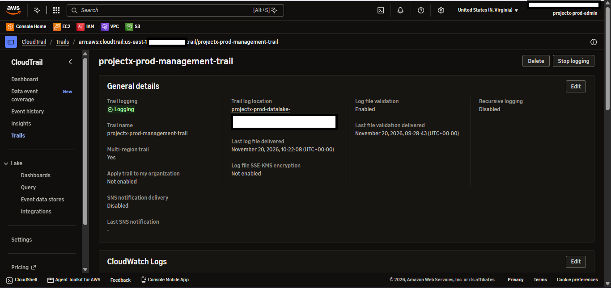
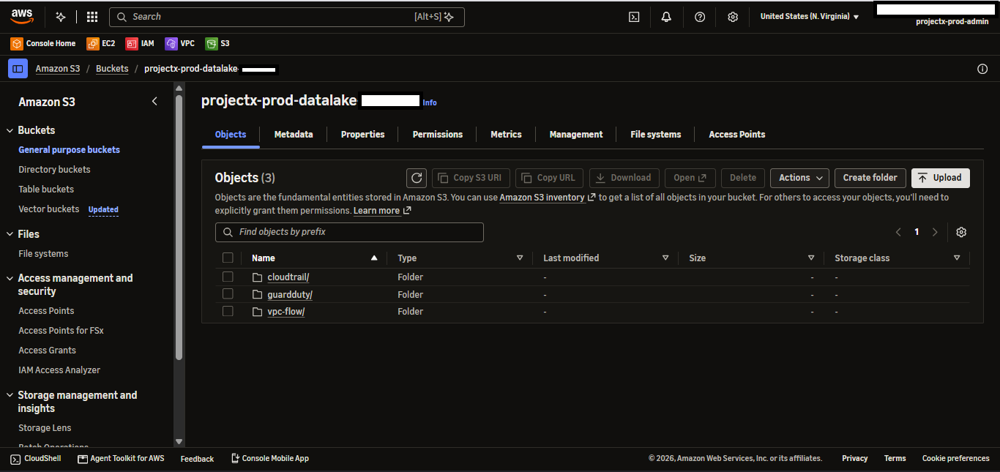
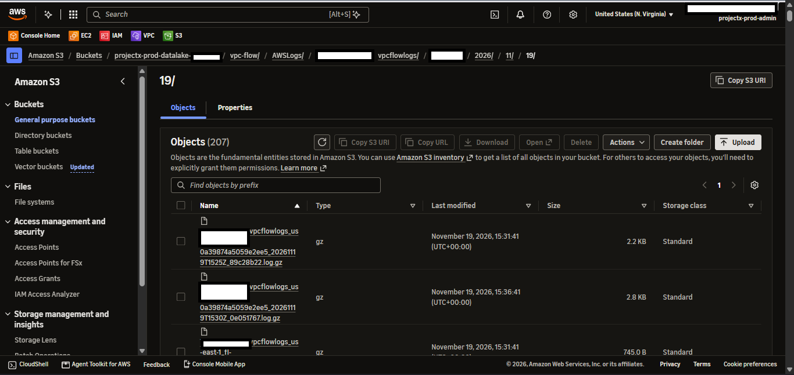

# 05: Monitoring and Logging

## Goal

Collect the logs and findings needed to see what happens in the account and the network, and store them in one central S3 bucket.

## Why

Preventive controls like subnets and security groups will eventually be misconfigured or bypassed, so detection matters. Each source answers a different question: CloudTrail records who did what in the account (API activity), VPC Flow Logs record who talked to whom on the network. Sending everything to a single bucket gives the SIEM one place to read from and keeps an audit trail that is separate from the resources being monitored.

## Design

| Source           | Answers                                                    | Destination                   |
| ---------------- | ---------------------------------------------------------- | ----------------------------- |
| AWS CloudTrail   | Who called which AWS API, from where, and when             | `security-datalake` S3 bucket |
| VPC Flow Logs    | Accepted and rejected traffic at the network level         | `security-datalake` S3 bucket |

**Key decision:** 
1. GuardDuty was replaced with Wazuh as the detection layer for now, to practice building and tuning detection rules myself and to avoid GuardDuty’s per-volume charges.
2. S3 lifecycle rules were created for both CloudTrail and VPC Flow Logs to be automatically deleted after 14 days. This was done to control storage costs.
3. Recursive logging was disabled to avoid a feedback loop where log writes to the data lake generate further events, which would inflate storage costs and flood Wazuh with noise. In production, logs for the data lake would go to a separate bucket, ideally in a dedicated log-archive account, so the bucket is monitored without a loop. <!-- e.g. one central bucket for all security logs, and why; trail scope (all regions or one); flow log filter (all vs rejected only) -->

| Decision                                 | Reason                                  | Tradeoff                                                       |
| ---------------------------------------- | --------------------------------------- | -------------------------------------------------------------- |
| Wazuh instead of GuardDuty               | Hands-on detection practice, lower cost | No managed threat intelligence                                 |
| Recursive logging disabled               | Prevent a feedback loop                 | No visibility into the bucket’s own activity                   |
| No CloudWatch Logs                       | Single destination, lower cost          | No real-time metric filters or alarms                          |
| S3 lifecycle rules(14-day log retention) | Storage costs control                   | Limited forensic history and no long-term compliance retention |

## What I did

Created the `security-datalake` bucket with public access blocked<!-- encryption, public access blocked, versioning -->, enabled CloudTrail for management and data events<!-- multi-region? management events only? --> and enabled VPC Flow Logs on `projectx-prod-vpc`  for all network traffic entering and exiting the VPC.<!-- traffic type, destination -->.

## Bucket policy

The bucket policy grants CloudTrail and VPC Flow Logs permission to write to the bucket, scoped by source ARN and account: [infra/datalake-bucket-policy.json](../infra/datalake-bucket-policy.json).

## Verification

- Objects from each source appear in the bucket under their own prefix
- A test action is logged in CloudTrail and stored in the bucket.

- <!-- a GuardDuty sample finding generated and visible -->
- <!-- rejected traffic visible in Flow Logs, such as a blocked SSH attempt -->

<!-- One or two screenshots: the bucket prefixes, and a CloudTrail event or GuardDuty finding. Redact account ID and IPs. -->

## Production hardening

- Enable S3 Object Lock or MFA delete so logs cannot be tampered, even for privileged users, with the right configurations.
- Use CloudTrail log file validation and send logs to a separate, dedicated log-archive account.
- Retain logs for 12+ months and archive older logs to S3 Glacier to control cost.